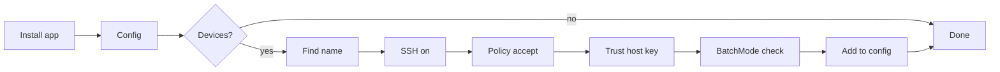

# Set up Hoarder

Gets Hoarder installed on this Mac, configured, and watching other machines over SSH. The README is the source of truth for every detail; this skill is the order to do things in and how to check each step. Read `README.md` sections Install, Devices, Tailscale setup and Config before starting.



## Ground rules

- Never run a cleanup command from a report. Setup only reads; deleting is the user's call from the popover.
- Ask before anything that needs `sudo`, changes the tailnet policy, or touches `~/.ssh/authorized_keys` on another machine. Those are the user's to approve; use `request_secret` for a sudo password, never a chat ask.
- Never open ports or use `tailscale funnel`. Hoarder only needs plain `ssh` across the tailnet.
- Edit `~/.config/hoarder/config.json` in place and keep keys you do not recognise. Read it first.

## 1. Install the app

```sh
gh release download --repo wezzcoetzee/hoarder --pattern '*.dmg' --dir /tmp/hoarder-dmg
hdiutil attach /tmp/hoarder-dmg/*.dmg -nobrowse -mountpoint /tmp/hoarder-mnt
cp -R /tmp/hoarder-mnt/Hoarder.app /Applications/
hdiutil detach /tmp/hoarder-mnt
xattr -dr com.apple.quarantine /Applications/Hoarder.app
open /Applications/Hoarder.app
```

From a checkout instead: `./scripts/bundle.sh --install` (needs Swift; installs to `~/Applications`).

Check: `pgrep -x HoarderApp` prints a pid. Notifications need the user to allow them in the prompt the app shows.

## 2. Config

Every key is optional, so a missing file is fine. Only write what the user wants to differ from the defaults in `Sources/HoarderCore/Config.swift`. The usual change is `projectRoots`, if their code does not live in `~/Development`.

Check the file parses and the scan sees what they expect:

```sh
swift run hoarder        # from a checkout, or skip if only the app is installed
```

An invalid file makes the CLI exit with `Invalid …/config.json` and Settings go read-only.

## 3. Add a device (per machine)

Work out the `host` first: `tailscale status` (on macOS the CLI may only be at `/Applications/Tailscale.app/Contents/MacOS/Tailscale`). Use the second column, the MagicDNS name. Run `ssh -G <host> | grep '^hostname'` to catch a `~/.ssh/config` entry pointing somewhere else.

Then follow README "Tailscale setup" steps 2 to 4, by device OS:

| Device | SSH on | Auth |
|---|---|---|
| Linux | `sudo tailscale set --ssh` on the device (ask first) | tailnet identity; the policy's SSH rule must be `accept`, not `check` |
| macOS | System Settings, General, Sharing, Remote Login (the user does this) | `ssh-copy-id <host>` from this Mac |

A Linux device also needs `curl`, since it downloads its CLI from the release.

The step that decides everything:

```sh
ssh -o BatchMode=yes <host> true && echo ok
```

If it prints `ok`, Hoarder can reach it. If not, the error maps to the README's unreachable table: host key not trusted means the user runs `ssh <host>` once interactively (you cannot answer that prompt for them); permission denied means SSH or the policy is not set up yet.

Then add it, merging into the existing `devices` array:

```json
{ "devices": [{ "host": "homeserver" }] }
```

`alertBelowGB` and `projectRoots` per device are optional. The app picks up the change within a minute, or the user can use Settings, then the device, then Test connection, which runs the same calls a scan does.

## 4. Verify end to end

The first scan copies the CLI to `~/.local/share/hoarder/<build>/hoarder` on the device. Confirm it ran:

```sh
ssh -o BatchMode=yes <host> 'ls ~/.local/share/hoarder/*/hoarder && ~/.local/share/hoarder/*/hoarder --free'
```

That prints free space as JSON. Report back to the user what was installed, the config keys you changed, and each device's state.
