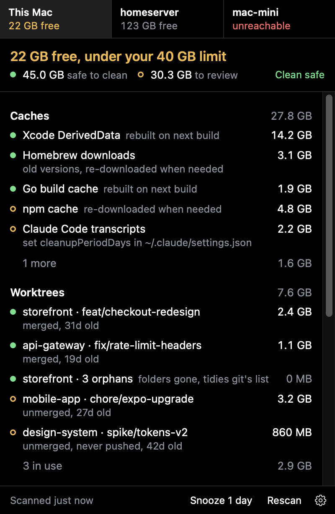
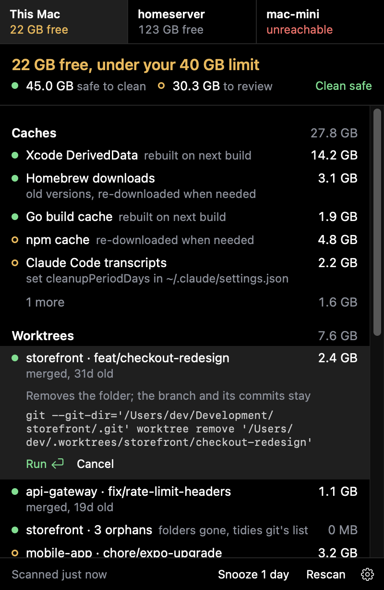
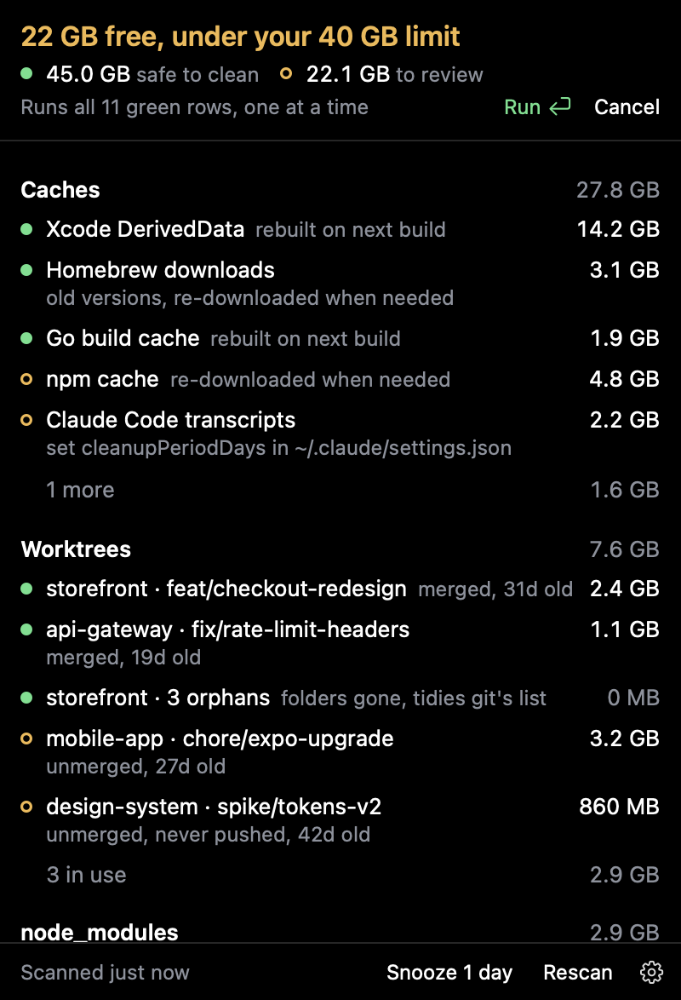
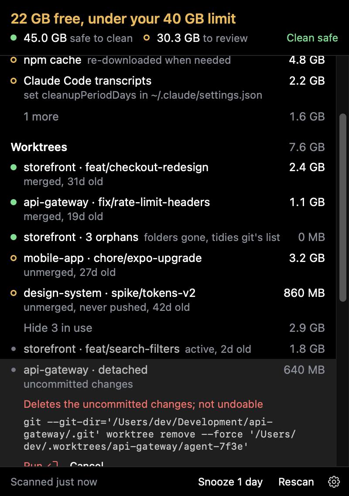
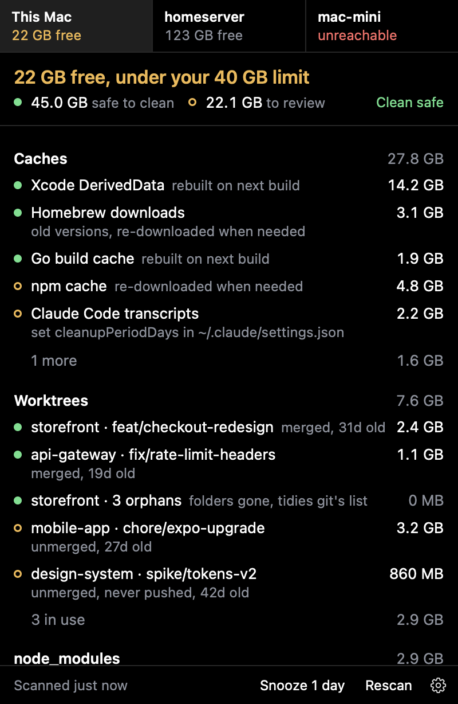
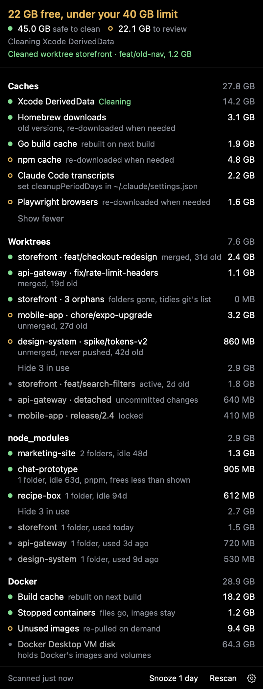
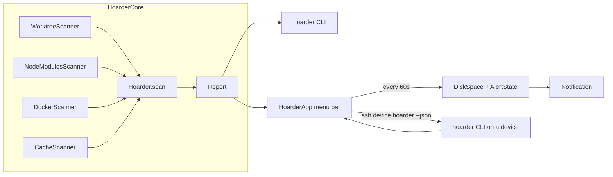
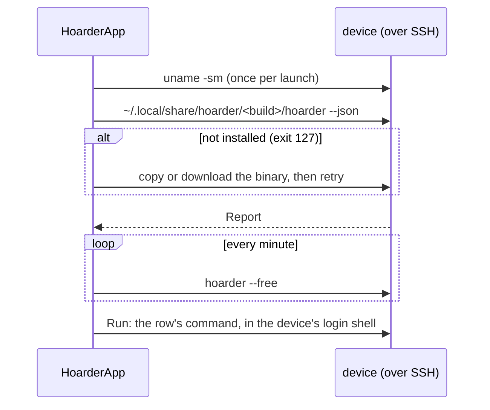

# Hoarder

A macOS menu bar app that watches free disk space and finds what agent coding leaves behind: git worktrees, node_modules, Docker build cache and images, and package manager caches. Each finding gets a verdict and the command that reclaims it. Other machines on your tailnet, Linux or Mac, can be watched and cleaned from the same popover over SSH.


| Popover | Click a row to see the command, then Run |
|---|---|
|  |  |

| Clean all safe rows at once | In-use rows clean too, forcing behind a warning |
|---|---|
|  |  |

| Other devices sit in a strip above the list |
|---|
|  |

<details>
<summary>Every section, with in-use rows shown and a clean running</summary>



</details>

Screenshots are rendered from a made-up report; see [Screenshots](#screenshots).



## Install

Download the DMG from [Releases](https://github.com/wezzcoetzee/hoarder/releases) and drag Hoarder to Applications.

The app is not notarized, so the first launch shows "Apple could not verify Hoarder". Click Done, then open System Settings, Privacy & Security, and click Open Anyway next to Hoarder. Or clear the quarantine flag:

```sh
xattr -dr com.apple.quarantine /Applications/Hoarder.app
```

## Run it

```sh
swift run hoarder              # scan and print a report
swift run hoarder --commands   # include each cleanup command
swift run hoarder --json       # machine-readable report
swift run hoarder --free       # free space as JSON, what the app asks devices every minute
swift run hoarder --root ~/src # scan these folders instead of projectRoots (repeatable)
./scripts/bundle.sh            # build dist/Hoarder.app
./scripts/bundle.sh --install  # and copy it to ~/Applications
swift scripts/make-icon.swift  # regenerate Support/AppIcon.icns after editing AppIcon.svg
```

Notifications and Open at login only work from the bundled app. To check the popover without the menu bar, render it from a saved report:

```sh
swift run hoarder --json > /tmp/report.json
swift run HoarderApp --snapshot /tmp/report.json /tmp/popover.png
```

That also writes the menu bar label to `/tmp/popover-menubar.png`. Pass `none` instead of a report to show the first scan. An optional third argument, a JSON state file, sets the rest; every key is optional (see `Snapshot.State`):

```json
{ "freeGB": 22, "alertBelowGB": 40, "scanning": false, "snoozed": false,
  "hovered": "worktree:/path", "confirming": "docker:Unused images", "confirmingSafe": false, "cleaning": "cache:/path",
  "expanded": ["worktree"], "showingKept": ["worktree"],
  "failures": { "worktree:/path": "fatal: …" }, "lastCleaned": "Cleaned …",
  "lastFailed": "Not cleaned: …", "notificationsOff": false, "full": true,
  "devices": [{ "host": "homeserver", "freeGB": 123, "alertBelowGB": 20, "problem": null }] }
```

## Screenshots

```sh
./scripts/screenshots.sh   # regenerate docs/screenshots
```

The README images come from `scripts/screenshots/report.json`, a made-up report, so no real paths ship. Each `scripts/screenshots/states/<name>.json` is a state file as above and renders to `docs/screenshots/<name>.png`; add one to add a shot. Rerun the script after UI changes.

## Verdicts

| Verdict | Meaning | Examples |
|---|---|---|
| reclaimable | nothing is lost by deleting it now | orphaned or clean+merged worktrees, node_modules idle 30d+, Docker build cache, Go build cache |
| review | probably dead weight, look first | clean unmerged worktrees 14d+, unused Docker images and volumes, download caches, agent transcripts |
| keep | in use; cleanable, never suggested | dirty, locked or recent worktrees, active node_modules, the Docker VM disk |

Worktree rules come from the `worktree-cleanup` skill: orphan, then hold (dirty, locked, under 14 days), then merged, then stale.

Clean all safe runs every reclaimable row's command, one at a time. Kept rows can be cleaned one by one: a recent worktree or active node_modules runs its plain command, while a dirty worktree uses `--force` and a locked one `-f -f`, with a red warning that the uncommitted changes go. Rows with no command (the Docker VM disk, app data) only show where they are.

## Alerts

Free space is read every minute (the `df` figure, not Finder's, which counts purgeable space). Below `alertBelowGB` the menu bar turns amber and one notification is sent per dip. Recovering re-arms it; Snooze silences it for a day, and Unsnooze (⌘S again) ends that early.

## Devices

List other machines under `devices` in the config and the popover gets a strip with each one's free space. Pick one (or ⌘1 to ⌘9) and the list below is that machine's, with the same verdicts, panels and Run.



- **SSH has to work without prompting.** Hoarder runs `ssh -o BatchMode=yes`, so it never answers a host key or password question. Run `ssh <host>` once by hand to accept the host key; until then the device shows as unreachable with that hint. Tailscale SSH or a key in `~/.ssh` both work, and Host entries in `~/.ssh/config` apply.
- **What it installs.** The first scan puts the CLI in `~/.local/share/hoarder/<build>/hoarder` on the device and removes older builds from that folder. Nothing else is written until you press Run. Mac devices get the copy bundled in the app; Linux devices download `hoarder-linux-<arch>` from this version's release (x86_64 and aarch64), so they need `curl`.
- **Paths are the device's own.** Its scan reads its own `~/.config/hoarder/config.json`, unless the device entry sets `projectRoots`. Caches are looked up where that OS keeps them (`~/.cache` on Linux). On Linux, Docker prunes free space on the disk directly, so those rows lose the "inside Docker's disk" note.
- **Alerts** work per device, with its own `alertBelowGB` if set, and are titled with the host. Another device under its limit tints the menu bar amber and adds "· 1 low".
- **Testing unreleased changes** on a Linux device: download the `hoarder-linux-<arch>` artifact from the PR's CI run into `dist/linux/`, then `./scripts/bundle.sh`. The bundled copy is used before any download.

## Config

`~/.config/hoarder/config.json`, every key optional. The gear menu's Edit config writes the defaults if the file is missing.

```json
{
  "alertBelowGB": 40,
  "idleNodeModulesDays": 30,
  "projectRoots": ["~/Development", "~/.t3/worktrees", "~/.codex/worktrees", "~/.cursor/worktrees"],
  "scanEveryMinutes": 60,
  "staleWorktreeDays": 14,
  "devices": [
    { "host": "homeserver", "alertBelowGB": 20 },
    { "host": "mac-mini", "projectRoots": ["~/src"] }
  ]
}
```

`devices` defaults to none. `host` is anything `ssh` accepts; `alertBelowGB` and `projectRoots` are optional per device.

## Known gaps

- Worktrees with only tool noise changed (`.vscode/settings.json`, a lockfile) count as dirty and are kept.
- Squash-merged branches are not detected, so they show as unmerged.
- pnpm and bun node_modules share blocks with their stores, so their sizes overstate what deleting frees.
- A full scan takes about 45s, almost all of it `du` walking node_modules.
- Mac devices get the CLI built for this Mac's architecture; an Intel Mac device needs a bundle built on Intel.
