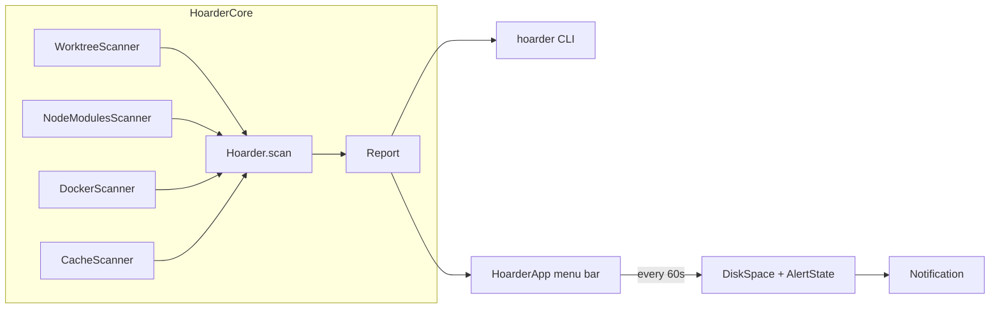

# Hoarder

A macOS menu bar app that watches free disk space and finds what agent coding leaves behind: git worktrees, node_modules, Docker build cache and images, and package manager caches. Each finding gets a verdict and the command that reclaims it.



## Run it

```sh
swift run hoarder              # scan and print a report
swift run hoarder --commands   # include each cleanup command
swift run hoarder --json       # machine-readable report
./scripts/bundle.sh            # build dist/Hoarder.app
./scripts/bundle.sh --install  # and copy it to ~/Applications
swift scripts/make-icon.swift  # regenerate Support/AppIcon.icns after editing AppIcon.svg
```

Notifications and Open at login only work from the bundled app. To check the popover without the menu bar, render it from a saved report:

```sh
swift run hoarder --json > /tmp/report.json
swift run HoarderApp --snapshot /tmp/report.json /tmp/popover.png
```

That also writes the menu bar label to `/tmp/popover-menubar.png`. Pass `none` instead of a report to show the first scan. An optional third argument, a JSON state file, sets the rest; every key is optional (see `Snapshot.State`):

```json
{ "freeGB": 22, "alertBelowGB": 40, "scanning": false, "snoozed": false,
  "hovered": "worktree:/path", "confirming": "docker:Unused images", "cleaning": "cache:/path",
  "expanded": ["worktree"], "cleanError": "…", "full": true }
```

## Verdicts

| Verdict | Meaning | Examples |
|---|---|---|
| reclaimable | nothing is lost by deleting it now | orphaned or clean+merged worktrees, node_modules idle 30d+, Docker build cache, Go build cache |
| review | probably dead weight, look first | clean unmerged worktrees 14d+, unused Docker images and volumes, download caches, agent transcripts |
| keep | in use, shown for size only | dirty, locked or recent worktrees, active node_modules, the Docker VM disk |

Worktree rules come from the `worktree-cleanup` skill: orphan, then hold (dirty, locked, under 14 days), then merged, then stale.

## Alerts

Free space is read every minute (the `df` figure, not Finder's, which counts purgeable space). Below `alertBelowGB` the menu bar turns amber and one notification is sent per dip. Recovering re-arms it; Snooze silences it for a day.

## Config

`~/.config/hoarder/config.json`, every key optional. The gear menu's Edit config writes the defaults if the file is missing.

```json
{
  "alertBelowGB": 40,
  "idleNodeModulesDays": 30,
  "projectRoots": ["~/Development", "~/.t3/worktrees", "~/.codex/worktrees", "~/.cursor/worktrees", "~/codeherder-sessions"],
  "scanEveryMinutes": 60,
  "staleWorktreeDays": 14
}
```

## Known gaps

- Worktrees with only tool noise changed (`.vscode/settings.json`, a lockfile) count as dirty and are kept.
- Squash-merged branches are not detected, so they show as unmerged.
- pnpm and bun node_modules share blocks with their stores, so their sizes overstate what deleting frees.
- A full scan takes about 45s, almost all of it `du` walking node_modules.
